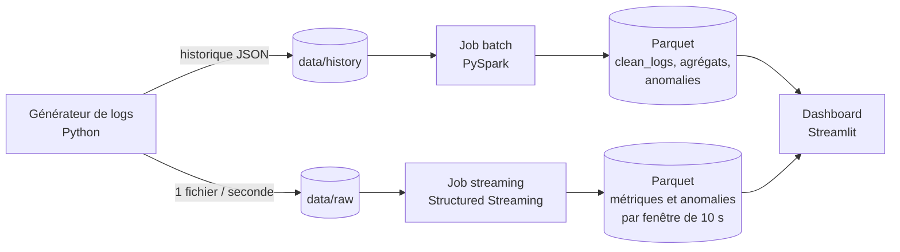
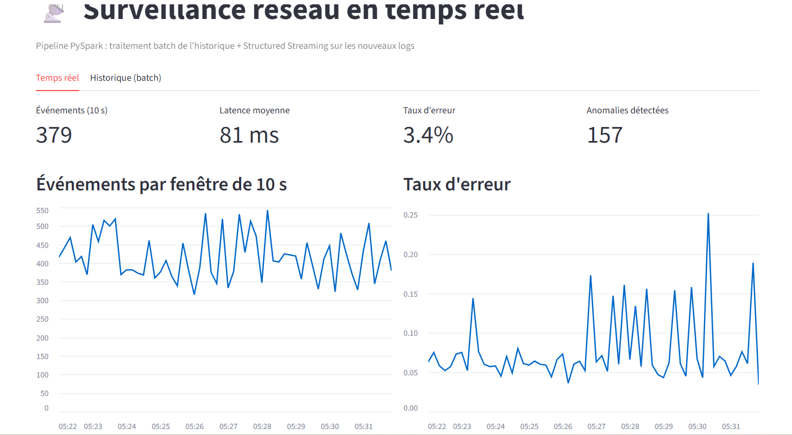
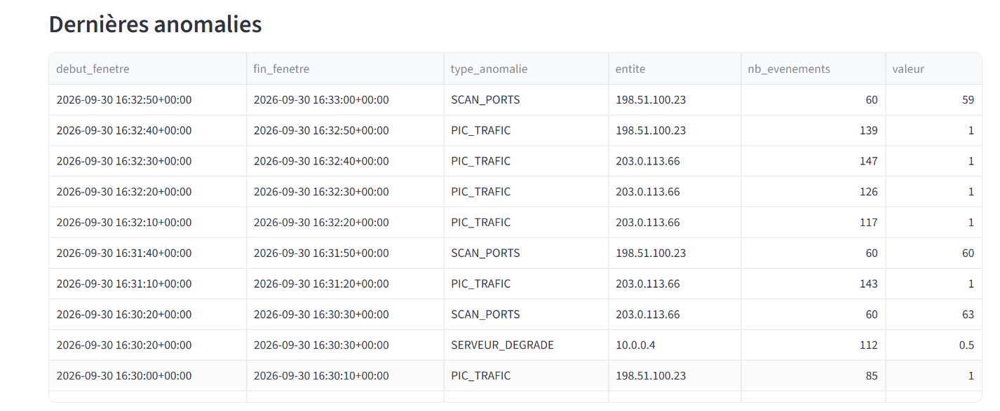
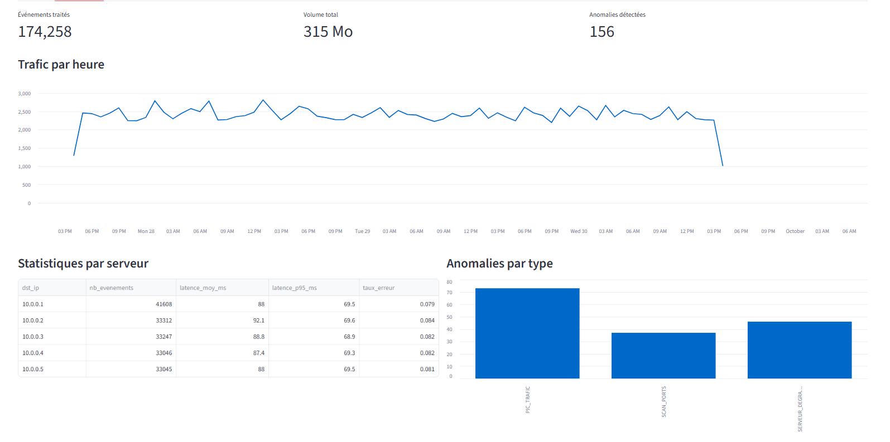

# Surveillance réseau en temps réel avec Apache Spark

Pipeline de données qui traite des logs réseau en **batch** (historique) et en **temps réel** (Spark Structured Streaming), détecte automatiquement des anomalies (pics de trafic, scans de ports, serveurs dégradés) et affiche les résultats dans un tableau de bord.

> Les logs sont générés par un simulateur inclus dans le projet, qui injecte volontairement des anomalies pour tester la détection.

## Architecture



## Stack

- **Apache Spark 3.5 (PySpark)** : traitement batch et Structured Streaming
- **Parquet** : stockage en colonnes, partitionné par date
- **Streamlit** : tableau de bord
- **Python** : génération des données simulées

## Ce que fait le pipeline

**Batch (`src/batch_job.py`)**
- lecture des logs JSON avec un schéma explicite
- nettoyage : conversion des timestamps, suppression des doublons et des valeurs invalides
- écriture des données propres en Parquet partitionné par date
- agrégations : trafic par heure, statistiques par serveur (latence moyenne, latence P95, taux d'erreur)
- détection d'anomalies sur des fenêtres d'une minute

**Streaming (`src/streaming_job.py`)**
- lecture continue des nouveaux fichiers de `data/raw`
- agrégations sur des fenêtres de 10 secondes avec watermark (gestion des événements en retard)
- trois requêtes en parallèle : métriques globales, anomalies par IP, anomalies par serveur
- écriture en Parquet avec checkpoints (reprise après arrêt sans perte ni doublon)

**Règles de détection**

| Anomalie | Règle (par fenêtre) |
|---|---|
| `PIC_TRAFIC` | une IP source envoie plus de 50 requêtes |
| `SCAN_PORTS` | une IP source contacte plus de 20 ports distincts |
| `SERVEUR_DEGRADE` | un serveur dépasse 25 % d'erreurs/timeouts (sur au moins 30 requêtes) |

## Structure

```
├── src/
│   ├── generate_logs.py   # simulateur de logs (modes history et stream)
│   ├── common.py          # schéma, session Spark, nettoyage, règles de détection
│   ├── batch_job.py       # traitement de l'historique
│   └── streaming_job.py   # traitement temps réel
├── dashboard/app.py       # tableau de bord Streamlit
└── requirements.txt
```

## Lancer le projet

Prérequis : Java 17 et Python 3.10+ (testé sous Ubuntu 24.04 / WSL2).

```bash
python3 -m venv .venv && source .venv/bin/activate
pip install -r requirements.txt

# 1. Historique + traitement batch
python src/generate_logs.py history --jours 3
python src/batch_job.py

# 2. Temps réel (deux terminaux)
python src/generate_logs.py stream        # terminal 1
python src/streaming_job.py               # terminal 2

# 3. Tableau de bord (troisième terminal)
streamlit run dashboard/app.py
```

## Pistes d'amélioration

- remplacer les fichiers par **Apache Kafka** comme source de streaming
- stocker les résultats dans **PostgreSQL** ou **Elasticsearch** et visualiser avec **Grafana**
- passer au format **Delta Lake** pour des écritures transactionnelles
- conteneuriser l'ensemble avec **Docker Compose**
## Aperçu du tableau de bord

**Temps réel** : métriques par fenêtre de 10 secondes



**Anomalies détectées en streaming**



**Historique** : résultats du traitement batch


